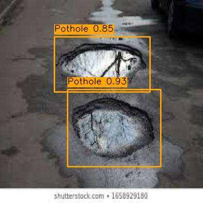
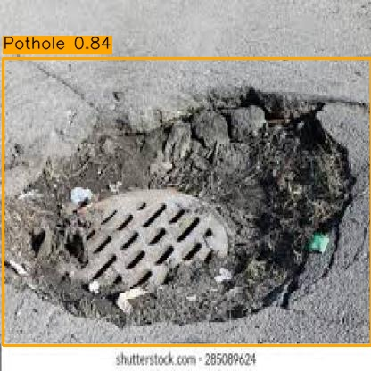
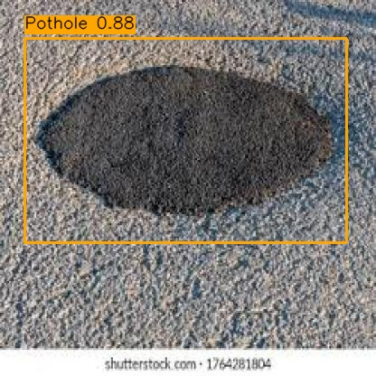

# CiviScan

CiviScan is an AI-powered civic infrastructure intelligence system built on the existing PotholeGuard-AI detection, database, and training workflows. It provides role-based reporting and municipal issue management while retaining the existing YOLOv8 and YOLOv3 inference paths.

## Overview

This project provides an integrated civic-reporting workflow around the existing YOLO detection models. A shared inference service is used by citizen image uploads and by a separate incoming-media worker. It continues to use the configured pothole checkpoint unless a different checkpoint is explicitly selected.

Current capabilities:

- Role-based citizen and municipal-officer access
- YOLOv8 pothole detection with optimized inference settings
- Custom YOLOv3-Tiny training and inference pipeline
- Civic issue submissions and citizen report history
- Municipal issue management, priority analysis, geographic hotspots, and GIS map
- Shared CiviScan light/dark design system
- Shared class-aware YOLO inference, saved detections, model version, and inference timing
- Incoming image/video queue with one-shot and watch-mode worker, deduplication, processing history, and annotated results
- Configurable video frame sampling and configurable indicative maintenance-cost assumptions
- Validation plots, confusion matrix, and saved sample detections

## Application Architecture

- `app.py`: Streamlit entry point and application routing
- `civiscan/ui/`: shared theme, reusable UI components, and role-aware navigation
- `civiscan/pages/municipal.py`: municipal overview, issue management, GIS, and analytics pages
- `auth.py` and `database.py`: authentication and SQLite persistence (existing interfaces retained)
- `inference.py` and `inference_yolov8.py`: existing model inference and media-processing workflows
- `priority.py` and `postprocess.py`: priority scoring, severity/cost post-processing, and hotspot/GPS utilities
- `config.py`: application paths, model selection, confidence threshold, and runtime directories

Incoming-media ingestion and an initial cost-settings page are implemented. Full repair assignment/verification, notification delivery, dataset administration, and evaluation comparison remain future work; see [docs/architecture.md](docs/architecture.md) for current limits.

## Runtime Configuration

The app reads optional settings from environment variables:

- `CIVISCAN_DATABASE_PATH`: SQLite file; defaults to the existing `civiscan.db`
- `CIVISCAN_MODEL_PATH`: preferred YOLO model checkpoint; defaults to `model.pt`
- `CIVISCAN_YOLOV8_FALLBACK_PATH`: existing fine-tuned checkpoint fallback
- `CIVISCAN_INCOMING_MEDIA_DIR`, `CIVISCAN_PROCESSED_MEDIA_DIR`, `CIVISCAN_ANNOTATED_RESULTS_DIR`, `CIVISCAN_UPLOAD_DIR`: media storage locations
- `CIVISCAN_INCOMING_IMAGE_DIR`, `CIVISCAN_PROCESSING_DIR`, `CIVISCAN_DATA_PROCESSED_DIR`, `CIVISCAN_FAILED_MEDIA_DIR`, `CIVISCAN_EXTRACTED_FRAMES_DIR`, `CIVISCAN_ANNOTATED_MEDIA_DIR`: incoming-worker storage paths
- `CIVISCAN_FRAME_INTERVAL_SECONDS`, `CIVISCAN_MAX_VIDEO_FRAMES`, `CIVISCAN_INCOMING_POLL_SECONDS`: video sampling and watch-mode limits
- `CIVISCAN_CONFIDENCE_THRESHOLD`: active YOLOv8 confidence threshold
- `CIVISCAN_THEME`: initial `Light` or `Dark` appearance
- `CIVISCAN_AUTH_MAX_LOGIN_ATTEMPTS` and `CIVISCAN_AUTH_LOCKOUT_MINUTES`: failed-login lockout policy
- `CIVISCAN_PASSWORD_RESET_TTL_MINUTES`: reset-link expiry
- `CIVISCAN_SMTP_HOST`, `CIVISCAN_SMTP_PORT`, `CIVISCAN_SMTP_USERNAME`, `CIVISCAN_SMTP_PASSWORD`, `CIVISCAN_SMTP_FROM_EMAIL`: password-reset email transport (set secrets in the environment, never in source)
- `CIVISCAN_PUBLIC_URL`: base URL used to construct password-reset links

In this checkout, `model.pt` is not present. CiviScan therefore uses `yolov8_pothole_best.pt`, and automatically prioritizes `model.pt` once that file is supplied. To select a supplied multi-class checkpoint explicitly, set `CIVISCAN_MODEL_PATH` to that file (for example `.\best.pt`). The app reads class names from model metadata; do not treat the repository's pothole-only weights as a garbage or streetlight detector.

## Authentication Administration

Citizens can register with their name, email, phone, and password. Public registration cannot create Municipal Officer accounts. Create the first administrator interactively from the project root:

```bash
python -m civiscan.admin_setup
```

The command refuses to run once an active administrator exists and prompts for the initial password without echoing it. Administrators can create, activate, deactivate, and grant administrator access to officer accounts in the application. Legacy usernames and PBKDF2 hashes remain valid; on successful login, legacy hashes are upgraded to Argon2id without changing user IDs or issue ownership. Password reset email requires SMTP environment configuration above.

## Models in the Repository

### YOLOv8

- Base model: `yolov8n.pt`
- Fine-tuned weights: `yolov8_pothole_best.pt`
- Training script: `train_yolov8.py`
- Optimized inference script: `inference_yolov8.py`

The latest no-retrain YOLOv8 deployment settings used in this project are:

- `conf = 0.44`
- `post-filter confidence >= 0.45`
- `iou = 0.55`
- `agnostic_nms = True`
- `max_det (raw) = 8`
- `max displayed detections = 5`
- `min box area = 800`
- `aspect ratio range = 0.3 to 3.0`
- `augment = True`

### YOLOv3-Tiny

- Model definition: `model.py`
- Training script: `train.py`
- Inference pipeline: `inference.py`
- Evaluation pipeline: `evaluate.py`
- Explainability: `gradcam.py`

## Latest YOLOv8 Validation Metrics

These values were generated from the saved model `yolov8_pothole_best.pt` and written to `evaluation_metrics/metrics_summary.txt`.

| Metric | Value |
| --- | ---: |
| Precision | 0.730839 |
| Recall | 0.699805 |
| mAP50 | 0.732630 |
| mAP50-95 | 0.357677 |

Validation artifacts are saved in [`evaluation_metrics/`](evaluation_metrics), including:

- `BoxF1_curve.png`
- `BoxPR_curve.png`
- `BoxP_curve.png`
- `BoxR_curve.png`
- `confusion_matrix.png`
- `confusion_matrix_normalized.png`
- `metrics_summary.txt`
- `metrics_summary.json`

## Saved Cleaned Detection Images

These three images were generated with the cleaned YOLOv8 inference flow and are included in the repository.

### sample_detection_1.jpg



### sample_detection_2.jpg



### sample_detection_3.jpg



## Project Structure

```text
PotholeGuard-AI/
|-- app.py
|-- config.py
|-- dataset.py
|-- evaluate.py
|-- gradcam.py
|-- inference.py
|-- inference_yolov8.py
|-- model.py
|-- train.py
|-- train_yolov8.py
|-- utils.py
|-- requirements.txt
|-- pothole_dataset.yaml
|-- yolov8_pothole_best.pt
|-- yolo_rdd_1.pth
|-- yolo_rdd_3.pth
|-- dataset_yolo/
|-- dataset-pothole-main/
|-- evaluation_metrics/
|-- results/
`-- runs/
```

## Installation

### 1. Clone the repository

```bash
git clone https://github.com/Yug-doshi/PotholeGuard-AI.git
cd PotholeGuard-AI
```

### 2. Install dependencies

```bash
pip install -r requirements.txt
```

## Requirements

Main dependencies:

- Python 3.10+
- PyTorch
- Torchvision
- OpenCV
- Streamlit
- Matplotlib
- Pillow
- Ultralytics

## Run the Project

### Launch the Streamlit app

```bash
streamlit run app.py
```

### Process incoming media

Place JPG, JPEG, PNG, WEBP, MP4, AVI, MOV, or MKV files in `data/incoming_images/`.

```bash
python -m civiscan.workers.incoming_worker --once
python -m civiscan.workers.incoming_worker --watch
```

`--watch` polls continuously until interrupted. Source files, sampled frames, annotations, and failures are stored under `data/`. The officer Incoming Media page can queue files and launch a one-time scan.

### Run YOLOv8 inference on a single image

```bash
python inference_yolov8.py path/to/image.jpg
```

### Run YOLOv3 inference

```bash
python inference.py path/to/image.jpg
```

### Validate the YOLOv8 model

```bash
python train_yolov8.py --validate-only
```

### Run the YOLOv3 evaluation pipeline

```bash
python evaluate.py
```

## Web App Highlights

The Streamlit interface supports:

- Citizen and Municipal Officer roles
- Image upload and pothole detection
- Detection summaries, confidence, severity, priority, and repair estimates
- Citizen issue submission and report history
- Municipal issue review, status updates, analytics, hotspots, and GIS map
- Incoming image and video processing with database-backed job history
- Light and dark themes

YOLOv8 is the recommended inference option in the app.

## Datasets and Weights Included

This repository currently includes:

- The YOLO-format dataset in `dataset_yolo/`
- The original pothole dataset in `dataset-pothole-main/`
- Trained YOLOv3 weight files
- Fine-tuned YOLOv8 weight files
- Training and validation outputs under `runs/`
- Fresh validation outputs under `evaluation_metrics/`

## Notes

- No retraining was required for the latest deployment cleanup.
- The latest cleaned detections are already saved in `evaluation_metrics/`.
- The evaluation metrics listed above come from the current saved YOLOv8 model in this repository.

